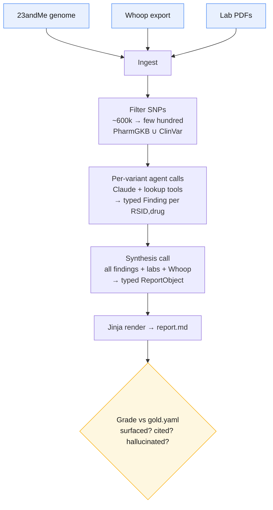

# dna-analysis-saas

**An n-of-1 health agent: fuse your genome + wearable + lab data into a personalized, cited health report.**

Ingests a 23andMe raw genome, a Whoop export, and lab PDFs, then runs an agent loop that produces a structured medical report — pharmacogenomic (PGx) flags, lab observations, and lifestyle/genotype correlates — with **every clinical claim cited to a guideline**.

This is the V1 backend prototype (CLI, single-user, runs locally). The interesting part isn't the plumbing — it's the **eval**: how do you know an LLM-written health report is trustworthy enough to act on? Built eval-first, with a graded gold set and a zero-tolerance hallucination check.

> ⚠️ Not medical advice. A stack-validation prototype run on a mixed synthetic subject (a public [PGP](https://www.personalgenomes.org/) genome + synthetic wearable/lab data), not a product.

## The pipeline



1. **Ingest** — parse the 23andMe export, summarize 90 days of Whoop (HRV recovery, strain, sleep, RHR), extract lab values from PDFs via Claude vision.
2. **Filter** — intersect ~600k SNPs down to the few hundred that appear in PharmGKB or ClinVar.
3. **Per-variant loop** — each variant gets a Claude call with same-gene neighbours in context (diplotypes matter) and lookup tools; returns a typed `Finding`.
4. **Synthesis** — one call sees all findings + labs + Whoop summary at once and returns a typed `ReportObject`, rendered to `report.md`.
5. **Grade** — the report is scored against a hand-built gold set (`gold.yaml`): did it surface the variant, cite the right guideline, and — the fatal check — did it hallucinate any drug or gene name?

## Why eval-first

An LLM will happily write a confident, wrong health report. The guardrails:

- **Name allowlist** — every drug / gene / condition in the report must belong to a closed set derived from the reference databases. Any invented name fails the grade, hard.
- **Gold set** — known-truth (RSID, drug) pairs verified against PharmGKB/CPIC, so output is graded, not vibed.
- **Citations required** — each clinical claim carries a `guideline_id` / `citation_url`.

## Stack

Python 3.11+ · Anthropic SDK (`claude-opus-4-7`, 1M context) · `pandas` for genome parsing · Claude vision for lab PDFs · Pydantic typed intermediates · Jinja rendering · prompt caching for the static reference tables.

Reference data: PharmGKB/CPIC guidelines, ClinVar summaries, PGS Catalog weights.

## Design notes

A few deliberate calls: **per-variant** agent calls rather than one giant prompt, so each variant is interpreted with its same-gene neighbours in context (diplotypes matter); a **hybrid grader with no LLM-as-judge**; lab PDFs read via **vision with a verbatim-match guard**; and PRS deferred until it's actually gradable.

## Status

V1 prototype — it runs end-to-end and produces a graded report. No web app, API, auth, or deployment yet (that's V2). Currently on ice.

## Known limitations & what's next

**Limitations (by design, for V1)**

- **Single-user, local, single-shot** — no web app, API, auth, or persistence; you run it on your own machine against your own files.
- **Narrow PGx scope** — a handful of high-impact gene–drug pairs, not the full CPIC catalogue.
- **No polygenic risk scores** — PRS is deliberately deferred: ancestry-sensitive and hard to grade against a rubric.
- **Synthesis faithfulness is hand-graded** — the "is the prose faithful to the findings" check is a manual read; only *surfaced / cited / no-hallucination* are scored programmatically.
- **Mixed synthetic subject** — validates the stack, not a real person; genome, wearable, and labs come from different sources.
- **Lab extraction trusts vision** — PDF → values via Claude vision with a verbatim-match guard, but no second OCR cross-check.

**Next**

- V2 web layer — the module boundaries already map to ingest / ETL / agent / grader / report domains.
- Broaden the gold set and PGx coverage; add PRS once it's gradable (ancestry-aware calibration).
- Automate the faithfulness grade — structured-field cross-checks instead of a human read.
- Confidence calibration — surface how sure the agent is, not just what it found.
- Persistence + longitudinal tracking — re-run over time and diff reports.
- Wider wearable ingest beyond Whoop (Oura, Apple Health, CGM).

## Run

```bash
uv sync                                    # install
dna-analysis etl --from ./refs --out ./data/etl        # build reference tables once
dna-analysis run \
  --genome ./data/genome.txt \             # 23andMe raw export
  --etl-dir ./data/etl \
  --whoop  ./data/whoop.csv \              # optional: lifestyle observations
  --labs   ./data/labs/*.pdf \             # optional: lab observations
  --gold   gold.yaml \                     # optional: grade (a)(b)(c)
  --out    ./out
```

`--no-agent` runs ingest + filter only; `--max-variants N` caps cost during dev. There's also a `grade-stub` command that scores the canned fixture as a smoke test.

Raw genome / wearable / lab data lives in `data/`, which is gitignored — kept local, never committed.
